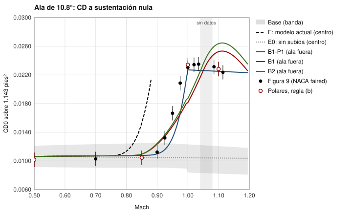
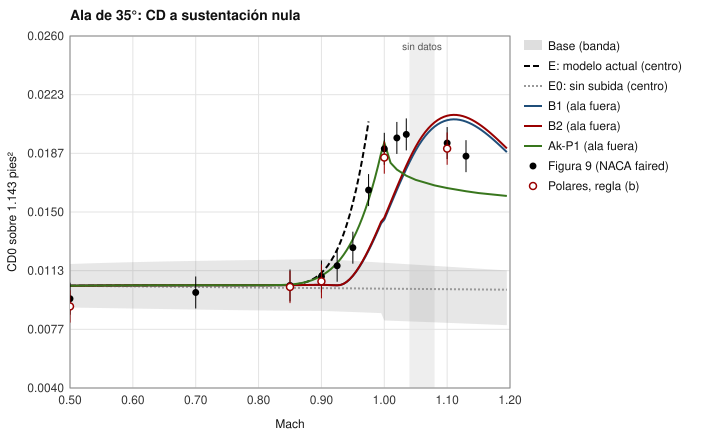
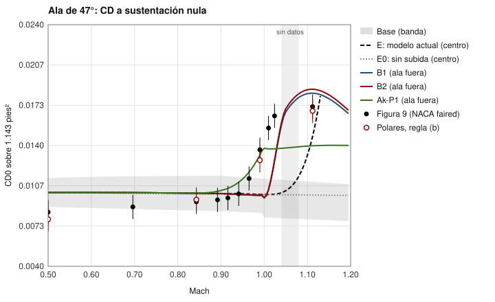
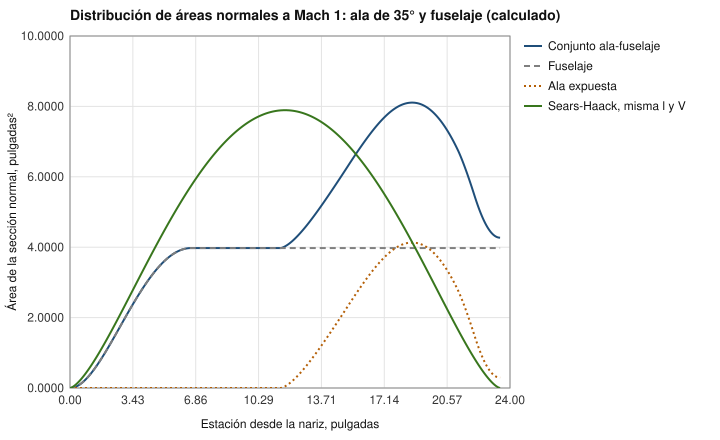
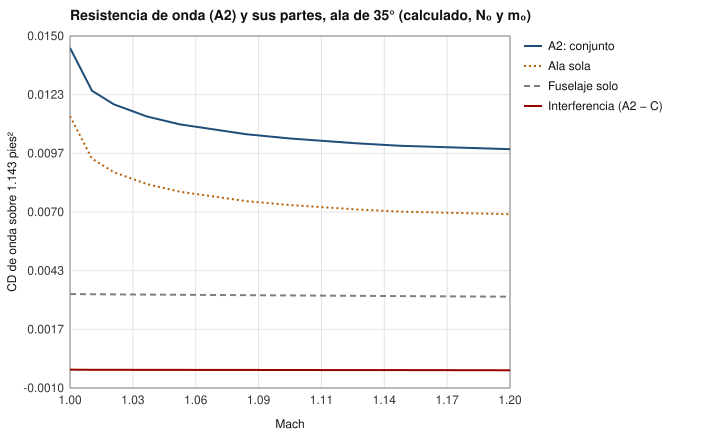

# Estudio 001 · Cómo cruzar Mach 1: método para la resistencia de onda

Estudio del brief 004 (carril C), con la fase B de la compuerta 3. **Generado por `studies/001-wave-drag/run.ts` desde `studies/001-wave-drag/study.template.md`: ninguna cifra de este texto está escrita a mano.** Las cifras vienen marcadas con su clase: `measured` y `NACA faired` son datos; `computed` es cálculo de este estudio; `report text` es una cifra del texto de un informe; lo que va como **juicio** es opinión de la sesión constructora.

## 1. Resumen

- **Recomendación de la regla A.9 del prerregistro:** {{n:recommended}}, **{{n:verdict}}**. Condiciones que no cumple: {{n:reasons}}.
- Métrica principal de {{n:recommended}} (media cuadrática de E en T2 y T3 con el ala fuera, 24 muestras, `computed`): {{n4:recMain}}; en T3: {{n4:recT3}}. La línea base E da {{n4:eMain}} en las {{n0:ePredicted}} muestras que predice de las 24; E0 da {{n4:e0Main}}.
- Las tres primeras curvas que pueden recomendarse: {{n:top1}}, {{n:top2}} y {{n:top3}}. B1-P1, añadido después de la compuerta 1, queda por delante en la tabla, pero no puede recomendarse (sección 5).
- **Juicio.** {{n:recommended}} es la curva más sencilla de todas: el nivel de un cuerpo de Sears-Haack con la misma área máxima y la misma longitud que el conjunto, sin ningún parámetro, y la forma en Mach de AeroSandbox. Tiene la menor métrica principal de las curvas que pueden recomendarse, pero no predice bien el inicio: su forma no llega a pendiente 0.1 en {{n0:recOnsetNA}} de las tres alas. La regla de áreas (A y C) predice bien el inicio con el puente P1 pero sobrestima mucho el nivel del ala de 10.8°, y en T3 con borde de ataque supersónico no converge. Lo que el dueño elige en esta compuerta es, por tanto, entre un método que acierta el nivel y no el inicio, y otro que acierta el inicio y no el nivel.
- **Una advertencia que pesa sobre {{n:recommended}}.** El prerregistro declaró (sección 0) que ya se conocían las subidas de la figura 9. B1 se fijó con E_WD = 1 por la regla "sin guía" y su nivel se calculó antes de leer datos (`docs/cp/004.md`, paso 3), pero la coincidencia con esas subidas puede ser suerte de esta familia de alas. La prueba a ciegas es la que lo dirá.

## 2. Qué se pregunta

Las seis preguntas del brief 004: el inicio de la subida, su nivel entre Mach 1.0 y 1.13, el puente entre el tramo subsónico y el supersónico, el fuselaje aislado, el coste y la explicación. Todo se juzga con el ala que queda fuera en tres rotaciones (R1: 10.8° fuera; R2: 35°; R3: 47°), como fija el prerregistro (A.4 y A.9).

## 3. Datos

- **Figura 9 de NACA RM L52B08** (`NACA faired`, 36 muestras): el dato `D` de todas las comparaciones.
- **Símbolos de las polares** (`measured`): convertidos a sustentación nula con una parábola (regla b, `computed`); solo comprobación.
- **Fuselaje aislado de RM L51I04a** (`measured`, dato abierto por la decisión 0004): pregunta 4.
- **Inicio de la subida:** de las muestras con la regla (c), salvo el ala de 47°, donde las muestras no llegan a 0.1 sin cruzar el hueco de 1.04 a 1.08 y se usa el texto del informe (`report text`: RM L52B08, p. 8, "from 0.92 to 0.97").
- **Nada de los datos reservados.** El registro de contaminación está en `docs/cp/004.md`.

## 4. Métodos

Definición completa en `studies/001-wave-drag/PLAN.md`. En breve:

- **Base común:** la banda actual de ocho variantes parásitas (factores de forma congelados en Mach 0.90, rozamiento al Mach de cada punto), más dos variantes con factor de forma 1 a partir de Mach 1. Coincide con la banda actual hasta Mach 0.90.
- **A, regla de áreas** (Jones, NACA Report 1284, pp. 757 a 759): A1 con cortes normales a Mach 1, A2 con planos de Mach por encima. Ak multiplica A2 por k.
- **C, teoría lineal por piezas:** ala expuesta sola más fuselaje solo, con la misma integral; A2 − C es la interferencia.
- **Puentes** entre la base y el nivel de Mach 1: P1 (cuarta potencia con M₀ libre), P2 (exponente libre) y P3 (Hermite), los dos últimos con M₀ de la relación de inicio {{n:relation}}.
- **B, Sears-Haack** (Jones, ec. A3) por E_WD con la forma de AeroSandbox; B1 con E_WD = 1, B2 con E_WD ajustado.
- **D, semejanza transónica** de Spreiter (NACA TN 2726, ec. 30): D1 es la media de las curvas propias de las dos alas de entrenamiento; D2, una logística de anchura 1.
- **E y E0:** el modelo actual y la base sin subida, de `packages/validation`, sin cambios.

### Verificación numérica (antes de leer datos)

Salida completa en `studies/001-wave-drag/out/verification.md`; el registro de congelación, en `out/freeze.md` (commit de congelación a83a2eb).

{{v:summary}}

### La nariz: la afirmación del PM, comprobada

{{v:nose}}

**Lectura (juicio sobre cifras `computed`).** Con borde de ataque supersónico, la nariz redondeada hace divergir la resistencia de la teoría lineal: el incremento por duplicación crece. Con la nariz poligonal de la tabla converge, pero solo con N del orden de miles y a un valor muy alto, porque el primer tramo de la tabla es una cuña muy abierta que la teoría lineal cuenta entera. Con borde casi sónico (47° a Mach 1.6) las dos narices convergen tarde. En esas condiciones la teoría lineal no tiene un valor bien definido para estas alas: depende del suavizado.

## 5. Resultados con datos abiertos

### Tabla principal

Métrica principal: media cuadrática de E = S − D (S el centro del intervalo predicho) en las 24 muestras T2 y T3, cada ala cuando queda fuera. Umbral {{t:thresholds}}. Todo `computed` frente a `NACA faired`.

{{s:candidates}}

El coste es la mediana del tiempo de una curva de 60 Mach para una geometría nueva, en milisegundos (sección 7).

**B1-P1, añadido después de la compuerta 1.** El PM lo propuso tras ver los errores de B1 por Mach en esta tabla: el nivel de Sears-Haack de B1 (E_WD = 1), constante por encima de Mach 1, al que se llega desde la base con el puente P1 (M₀ ajustado en cada rotación, un parámetro). Con datos abiertos da {{n4:main:B1-P1}} de métrica principal, {{n4:t3:B1-P1}} en T3 y {{n3:onset:B1-P1}} de mayor error del inicio. **No puede recomendarse ni lleva veredicto** (A.9, candidatos nuevos): se diseñó después de ver estos errores, así que su acierto aquí no es una prueba independiente. Va en `predictions-all.csv` como exploratorio; la prueba a ciegas dirá si el acierto era del método o de esta tabla.

### Parámetros ajustados

{{s:params}}

Parámetros que acaban en el borde de su rango:

{{s:bounds}}

**Juicio.** Un parámetro en el borde dice que la forma de esa curva no encaja con los datos aunque se le dé libertad, no que el rango sea corto.

### Predicciones por ala

{{s:perWing}}

### Figuras

### Pregunta 1: el inicio de la subida

{{s:onset}}

**Juicio.** Ninguna relación de inicio de un parámetro mejora a la del modelo actual con el ala fuera: la flecha efectiva (O-1) no puede mover el ala de 10.8°, cuya flecha en la mitad de la cuerda es casi nula, y la kA libre (O-2) empeora. El mejor inicio lo da la curva completa A2 o C con el puente P1.

### Pregunta 2: el nivel entre Mach 1.0 y 1.13

Ver la columna T3 de la tabla principal y las figuras. La regla de áreas sobrestima mucho el ala de 10.8°: su criterio de cuerpo esbelto falla (tabla de validez, abajo), y su borde de ataque es supersónico en T3.

### Pregunta 3: el puente

Mayor error del inicio con el ala fuera, en Mach: A2-P1 {{n3:onset:A2-P1}}, A2-P2 {{n3:onset:A2-P2}}, A2-P3 {{n3:onset:A2-P3}}; con C: {{n3:onset:C-P1}}, {{n3:onset:C-P2}} y {{n3:onset:C-P3}}. P2 y P3 toman M₀ de la relación de inicio y heredan su error.

### La anchura de los intervalos donde el borde de ataque es supersónico

En los datos abiertos, el ala de 10.8° en T3 (Mach normal al borde de ataque en la tabla y en `out/edges.md`). Descomposición del intervalo: la banda de base con los parámetros, el cambio hacia fuera de cada entrada incierta y si el barrido converge.

{{s:widths}}

**Lectura (juicio).** Donde la regla de áreas no converge, el prerregistro hace entrar la falta de convergencia dos veces: cada variante geométrica que no converge cuenta con todo su barrido (I1, I2, I7 e I8), y además el intervalo se extiende al barrido completo. Por eso el desplazamiento del ala de la entrada I1, una fracción de centésima de pulgada, aparece con un cambio del orden del suavizado. La regla se aplicó tal como está; es una pregunta para el PM antes de la fase B (sección 10). B y D no tienen este problema porque no tienen integral que converger. Con intervalos así, más anchos que el umbral de 0.003, la regla de A.7 impide que A o C salgan `acierta` en T3 aunque su centro acertara: es lo que el plan anunciaba en sus riesgos.

A Mach 1.60 (T4, sin datos abiertos) la verificación ya da el barrido del término de onda de A2 en las alas con borde de ataque supersónico y sónico (tabla de la nariz, columnas N = 32 a 128): es la parte del intervalo que vendrá de la convergencia.

### Pregunta 4: el fuselaje aislado

Modelo: rozamiento del fuselaje (banda turbulento y mixto, `model`) más su propia resistencia de onda A1 o A2 (`computed`, sin parámetros). Se juzga el nivel desde Mach 1.0.

{{s:body}}

### Comprobación con los valores (b) de las polares

{{s:polars}}

### Validez de las teorías

{{s:validity}}

β s/c_r es el criterio de cuerpo esbelto (pequeño es bueno); A τ^(1/3) < 1 es el de McDevitt para la teoría de cuerpo esbelto a Mach 1 (Report 1253, resumen); ξ₀ y à son los parámetros de Spreiter; Mn es el Mach normal a cada borde (sónico en 1).

## 6. Sensibilidad (paso 5)

Para las curvas que encabezan la tabla, el mayor cambio hacia fuera de cada límite por entrada incierta, en las condiciones T2 y T3:

{{s:sensitivity}}

## 7. Coste (pregunta 5)

- A y C: {{n1:costA}} ms por curva ({{n0:costAReps}} repeticiones en el tiempo máximo de 20 s). No es interactivo: casi todo es el cálculo de las áreas oblicuas y la serie en cada Mach por encima de 1.
- B: {{n1:costB}} ms, casi todo el área máxima de la geometría.
- E: {{n1:costE}} ms.
- **Qué lo haría interactivo (juicio).** El término de onda solo depende de la geometría y del Mach. Al soltar un control se calcula la tabla de A2 en los Mach por encima de 1 (el coste de arriba); mientras se arrastra, la curva se interpola en esa tabla, en microsegundos. Para B basta precalcular el área máxima, que no depende del Mach.

## 8. Explicación (pregunta 6)

La resistencia de onda cerca de Mach 1 depende de cómo cambia el área de la sección normal a lo largo del avión. El conjunto ala-fuselaje (azul) tiene un salto de área donde empieza el ala; el cuerpo de Sears-Haack de la misma longitud y el mismo volumen (verde) es el que menos resistencia tiene. La diferencia entre las dos curvas es lo que la regla de áreas convierte en resistencia.

## 9. Recomendación

**Regla A.9:** {{n:recommended}}, {{n:verdict}} ({{n:reasons}}).

**Juicio de la sesión constructora.** Para la lección, el método con más fundamento físico es la regla de áreas con el puente P1: predice el inicio y se explica con una imagen. Pero falla el nivel del ala de 10.8° y no converge con borde supersónico, y la regla del prerregistro no lo elige. Si el dueño elige {{n:recommended}}, la predicción a ciegas probará si el nivel de Sears-Haack con E_WD = 1 vale para otros espesores (6 y 9 %) y a Mach 1.60, donde no hay ningún dato abierto; su inicio ya sabemos que falla.

## 10. Preguntas para el PM y el dueño

1. **Doble cuenta de la falta de convergencia** en el intervalo (sección 5): ¿se mantiene la regla de A.9 para la fase B, o se enmienda para que una variante que no converge cuente con su valor en N₀? Si se enmienda, es `post hoc` y se informa con las dos reglas.
2. **Inicio de B:** la forma de AeroSandbox no llega a pendiente 0.1 en dos alas. Para la fase B, ¿la recomendación lleva el inicio de otra relación (por ejemplo O-E, sin parámetros) o se deja `NA`?
3. **El nivel de la regla de áreas en el ala de 10.8°.** ¿Vale la pena un candidato nuevo (A.9 permite añadirlos marcados "después de la compuerta 1") que use la regla de áreas solo donde el criterio de cuerpo esbelto se cumple?

## 11. Fase B: las predicciones a ciegas

- El dueño eligió {{n:recommended}} en la compuerta 2 ({{n:verdict}}). Respuestas a las preguntas de la sección 10: la regla del intervalo no se enmienda; el inicio de {{n:recommended}} queda como lo da su curva, y donde no llega a 0.1 es `NA` y cuenta como fallo; no se añade el candidato de regla de áreas con criterio de cuerpo esbelto; sí se añade B1-P1, como exploratorio.
- `studies/001-wave-drag/predictions.csv`: {{n0:predRows}} filas, {{n:recommended}} y la línea base en cada condición de la hoja de geometría; {{n0:predNA}} son `NA`. El inicio de {{n:recommended}} es `NA` en {{n0:recOnsetHeldNA}} de sus {{n0:recOnsetHeld}} configuraciones con barrido transónico.
- `studies/001-wave-drag/predictions-all.csv`: {{n0:allRows}} filas, las {{n0:allCurves}} curvas completas salvo E0 (la línea base E con el nombre `baseline-korn-mason-lock`); {{n0:allNA}} son `NA`. Solo {{n:recommended}} lleva veredicto; el resto se puntúa como exploratorio.
- Parámetros: los de las tres rotaciones, nunca un ajuste con las tres alas; la curva nominal usa su mediana. Intervalo: la regla registrada de A.9.
- Lo que queda sin datos abiertos: los espesores del 6 y del 9 %, la raíz engrosada y Mach 1.60. Ninguna curva se ha comparado nunca allí.

## 12. Límites y fórmulas sin verificar

- Sin verificar en fuente impresa: la forma cerrada del cuerpo de arco parabólico (deducida), la fórmula de Ackeret (solo como límite de la ec. A5 de Jones), el factor de forma 1 en supersónico, la forma de B tal como la escribe AeroSandbox frente a Raymer, y la afirmación sobre la nariz (comprobada solo en lo numérico).
- La resistencia de base del borde de salida romo no se modela. La resistencia de onda por curvatura a sustentación nula tampoco.
- D no ve la flecha: sus parámetros no la tienen (Spreiter no trata alas en flecha).
- Tres alas son pocas: con dos parámetros cualquier curva pasa cerca de dos alas; por eso solo cuenta el ala que queda fuera.

## 13. Medido, calculado y juicio

- **Medido o NACA faired:** solo las columnas D, u_D y los valores de las polares y del fuselaje.
- **Calculado:** todo lo demás de las tablas y figuras, regenerable con `corepack pnpm exec tsx studies/001-wave-drag/run.ts`.
- **Juicio:** los párrafos marcados así, la sección 9 y las preguntas de la sección 10.
- **Decisiones del dueño y del PM:** la sección 11.

## 14. La apuesta

Si {{n:recommended}} se elige y la prueba a ciegas sale bien en los espesores del 6 y 9 % y a Mach 1.60, el proyecto tendrá un nivel de resistencia de onda sin parámetros que se explica con una sola figura. Si sale mal, sabremos que la coincidencia con las alas abiertas era de esta familia y no del método, antes de haber construido nada encima.
