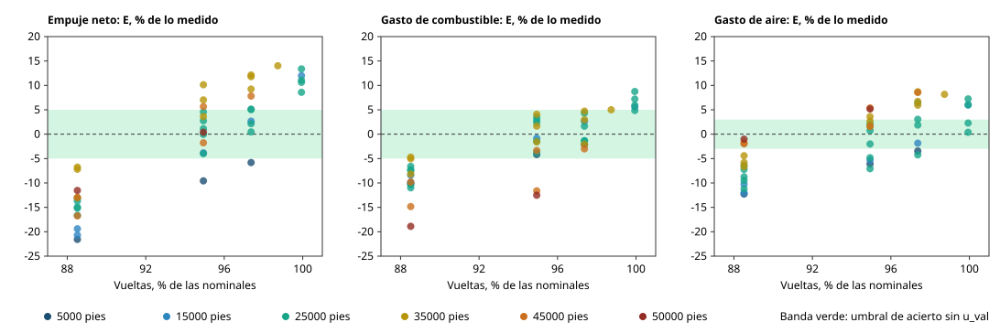

# Estudio 002 · El ciclo del motor: borrador con el J47

Estudio del brief 007 (carril E). **Borrador de la compuerta 2:** contiene el motor v0 y su comparación con el J47. Las preguntas del estudio que comparan métodos (gas, modelos fuera de diseño, límites, masa), pyCycle y la predicción a ciegas llegan en la compuerta 3.

**Generado por `studies/002-engine-cycle/run.ts` desde `studies/002-engine-cycle/study.template.md`: ninguna cifra de este texto está escrita a mano.** Cada cifra lleva su clase: `measured` es una medida del informe; `report text`, una cifra de su texto; `computed`, un cálculo de este estudio; `estimated`, un valor sin medida detrás. Lo que va como **juicio** es opinión de la sesión constructora. Las páginas son las del PDF de cada informe.

## 1. Resumen

- **El motor v0 no reproduce el J47 dentro del criterio prerregistrado.** De {{n:regions}} regiones de ensayo, {{n:comparedRegions}} cuentan como comparadas y **{{n:hitRegions}} aciertan**. De {{n:scoredPoints}} puntos puntuados, {{n:allThreeHits}} aciertan en las tres magnitudes a la vez.
- **Consecuencia, fijada antes de calcular:** el motor entero queda como `estimated`. Ninguna salida suya lleva `validated`.
- Mediana del error en valor absoluto (`computed` contra `measured`): empuje neto {{n:median:netThrust}} %, gasto de combustible {{n:median:fuelFlow}} %, gasto de aire {{n:median:airflow}} %. Máximos: {{n:max:netThrust}} %, {{n:max:fuelFlow}} % y {{n:max:airflow}} %.
- **La forma del error es clara** (sección 6): el modelo da de menos al bajar las vueltas y de más a régimen máximo lejos del ancla.
- **Lo que sí cuadra:** el área de tobera que el modelo necesita en el ancla está a un {{n:nozzleAreaDifferencePercent}} % de la geométrica del informe, y el motor llevado a nivel del mar da el gasto de aire nominal a un {{n:seaLevelAirflowDifferencePercent}} % y la relación de compresión a un {{n:seaLevelPressureRatioDifferencePercent}} % (secciones 3 y 4).
- **Parámetros:** cero ajustados a los puntos puntuados; {{n:anchorMeasuredCount}} valores medidos y {{n:anchorTextCount}} de texto tomados de una sola corrida, el ancla (sección 3).

## 2. Datos

Todo es del General Electric J47 ensayado en 1949 en el túnel de altura de Lewis, con la tobera estándar de {{n:nozzleArea_sq_in}} pulgadas cuadradas.

| Informe | Qué se usa | Clase |
| --- | --- | --- |
| NACA RM E9G09, tabla I (pp. 17 y 18) | Las {{n:runs}} corridas: condición, vueltas, empuje, gasto de aire y de combustible, temperatura de escape | `measured` |
| NACA RM E9G28, tabla I (pp. 14 y 15) | Corrida 1: presión y temperatura a la entrada y a la salida del compresor | `measured` |
| NACA RM E9L02, tabla I (pp. 18 y 19) | Corrida 1: presiones de la cámara; combustible | `measured` y `report text` |
| NACA RM E9K10, tabla I (pp. 18 y 19) | Corrida 1: presiones y temperatura de la turbina | `measured` |

- **Son tablas, no curvas.** No se digitalizó nada. Cada tabla se leyó dos veces, por dos lectores independientes que no vieron la lectura del otro. Las dos lecturas coinciden en todas las celdas; una prueba lo comprueba. La ficha está en `packages/physics/data/engines/j47/README.md`.
- **Las columnas derivadas cuadran.** El Mach, el consumo específico, la relación combustible-aire y la relación de temperaturas del motor, recalculados desde las otras columnas, coinciden con lo impreso en las {{n:runs}} corridas.
- **Lo que el informe no declara.** No da la precisión del empuje ni del gasto de combustible. Las incertidumbres de la sección 5 son, salvo la del gasto de aire, estimación propia.

## 3. El ancla

El modelo se ancla en una sola corrida, la {{n:anchorRun}}: {{n:anchorAltitude_ft}} pies, Mach {{n:anchorMach}}, {{n:anchorSpeed_rpm}} rpm. Es la de menor altura y menor Mach a régimen máximo, como fijó el plan. No se puntúa.

{{t:anchorInputs}}

Con esos valores, y con el gas del modelo (aire y productos de combustión con calor específico variable, coeficientes de NASA Glenn), se calcula una vez todo lo que el modelo mantiene constante. El informe no da el coeficiente de descarga de la tobera, así que el ciclo se cierra con la temperatura medida a la salida de la turbina, como preveía el plan.

{{t:anchorDerived}}

- **La comprobación que vale:** el área de tobera que necesita el modelo para dejar pasar el gasto medido coincide con la geométrica del informe. No se usó para cerrar.
- **Por qué no coinciden los rendimientos.** El modelo los recalcula con su gas y sin sangrados. Los informes los definen con calor específico constante o con sus gráficos, y restan del gasto de la turbina los sangrados que midieron: {{n:leakage_lb_s}} lb/s de fugas del compresor y {{n:cooling_lb_s}} lb/s de refrigeración, un {{n:bleedPercent}} % del aire.
- **Recuento.** Cero parámetros ajustados a los puntos puntuados. Del ancla se toman {{n:anchorMeasuredCount}} valores medidos y {{n:anchorTextCount}} de texto: los de la primera tabla.

## 4. El J47 parado a nivel del mar

El túnel no ensayó ahí. Estas cifras son las del modelo anclado llevado a nivel del mar, y son las que definen "el J47" entre las decisiones del jugador.

{{t:seaLevel}}

- El gasto de aire sale a un {{n:seaLevelAirflowDifferencePercent}} % de su valor nominal y la relación de compresión a un {{n:seaLevelPressureRatioDifferencePercent}} %.
- **El empuje y el consumo salen por encima del nominal, y no es un fallo del modelo (juicio).** El motor ensayado ya daba más que su cifra de catálogo: en la corrida del ancla, a {{n:anchorAltitude_ft}} pies, midió {{n:anchorJetThrust_lbf}} lbf de empuje del chorro con una presión de entrada que es el {{n:anchorInletPressurePercent}} % de la del nivel del mar.

Lo que el taller toma de aquí:

{{t:designBasis}}

## 5. La comparación

**Qué se compara.** El motor anclado predice las demás corridas: recibe la presión y la temperatura totales de entrada y la presión ambiente medidas en cada una, y las vueltas. Se puntúan el empuje neto, el gasto de combustible y el gasto de aire en las corridas por encima del {{n:highSpeedPercent}} % de las vueltas nominales.

**Cómo se informa.** Es una adaptación nuestra de ASME V&V 20, no el estándar. El error de comparación es `E = S − D`, modelo menos medida. La incertidumbre de validación es `u_val = sqrt(u_D² + u_num² + u_input²)`. Segunda diferencia con la regla del proyecto: este modelo itera, así que `u_num` no es cero; se estima apretando la tolerancia.

- `u_D`: {{n:uAir}} % del gasto de aire (`report text`: tres métodos coincidieron dentro de un {{n:airFlowAgreementPercent}} %, RM E9G09, p. 14; se toma la mitad); {{n:uJet}} % del empuje del chorro y {{n:uFuel}} % del gasto de combustible, estimación propia. El empuje neto compone el del chorro con el del gasto de aire, por la resistencia de entrada.
- `u_input`: lo que cambia cada salida al mover cada valor del ancla dentro de su incertidumbre. Mediana de `u_val`: {{n:medianUval:netThrust}} % en empuje, {{n:medianUval:fuelFlow}} % en combustible y {{n:medianUval:airflow}} % en aire.
- `u_num`: como mucho {{n:maxUnum:netThrust}} % del empuje. No pesa.

**El criterio, fusionado antes de abrir ningún informe** (`PLAN.md`, sección 6). Un punto acierta si `|E| ≤ max(u_val, {{n:threshold:netThrust}} %)` en empuje y en combustible, y con el {{n:threshold:airflow}} % en aire. Una región, que es una altura y un Mach, cuenta como comparada con al menos {{n:minPoints}} puntos puntuados y una mediana de `u_val` no mayor del {{n:maxMedianUvalPercent}} %; y acierta si lo hace al menos el {{n:minHitPercent}} % de sus puntos en las tres magnitudes.

### Por región

{{t:regions}}

No cuentan como comparadas, por tener menos de {{n:minPoints}} puntos: {{n:notComparedRegions}}.

### Por punto

{{t:points}}

Puntos que aciertan, de {{n:scoredPoints}}: empuje {{n:hits:netThrust}}, combustible {{n:hits:fuelFlow}}, aire {{n:hits:airflow}}. Dentro del umbral a secas, sin `u_val`: {{n:within:netThrust}}, {{n:within:fuelFlow}} y {{n:within:airflow}}. Puntos donde el modelo no encuentra punto de funcionamiento: {{n:noRunningPoint}}.

## 6. Por qué falla

### La forma del error (`computed`)

{{t:errorBySpeed}}

El error medio del empuje cambia con las vueltas: {{n:meanThrustErrorLowestSpeed}} % al {{n:lowestSpeedPercent}} % de las nominales, {{n:meanThrustErrorMiddleSpeed}} % al {{n:middleSpeedPercent}} % y {{n:meanThrustErrorHighestSpeed}} % al {{n:highestSpeedPercent}} %.

### Dos supuestos que el J47 no cumple (`report text` y juicio)

El modelo mantiene constantes el rendimiento del compresor y el cociente entre su trabajo y el cuadrado de las vueltas. Los dos valores son los del ancla, que está a régimen máximo.

- **El rendimiento del compresor no es constante.** RM E9G28 dice que el máximo fue de aproximadamente un {{n:compressorPeakEfficiencyPercent}} %, a unas {{n:compressorPeakEfficiencySpeed_rpm}} rpm corregidas, y que a las vueltas nominales baja del {{n:compressorEfficiencyLowAltitudePercent}} % a {{n:lowestTestedAltitude_ft}} pies al {{n:compressorEfficiencyHighAltitudePercent}} % a {{n:highestTestedAltitude_ft}} pies (pp. 3 y 11). El modelo usa en todas partes el del ancla, que se midió a régimen máximo, lejos de ese máximo de rendimiento. Al bajar las vueltas el compresor real rinde más, comprime más y traga más aire que el modelo: de ahí el error negativo.
- **A régimen máximo el compresor se satura.** El mismo informe dice que cerca de las vueltas nominales el gasto de aire deja de crecer porque la entrada del compresor se bloquea (p. 10). El modelo no tiene ese techo: con aire más frío a la entrada, que es lo que pasa en altura, sigue subiendo la relación de compresión y el gasto. De ahí el error positivo.
- **Juicio.** Un modelo sin mapa del compresor, anclado a régimen máximo, no puede acertar a la vez por debajo y por encima del ancla en este motor. Es lo que el plan preveía como el eslabón más débil del candidato A; el plan no preveía que fallara también por encima del {{n:highSpeedPercent}} % de las vueltas.

### La misma comparación a igual temperatura de escape (`computed`)

El plan (riesgo 2) preveía, si fallaba la ley de vueltas, comparar a la temperatura de salida de la turbina en vez de a las vueltas. Aquí cada punto se calcula a las vueltas a las que el modelo da la temperatura de escape medida. Es un diagnóstico: el motor se vuela por vueltas, así que no cambia el resultado de la sección 5.

{{t:temperatureMatched}}

Con la temperatura igualada, la mediana del error absoluto es {{n:matchedMedian:netThrust}} % en empuje, {{n:matchedMedian:fuelFlow}} % en combustible y {{n:matchedMedian:airflow}} % en aire, y quedan dentro del umbral a secas {{n:matchedWithin:netThrust}}, {{n:matchedWithin:fuelFlow}} y {{n:matchedWithin:airflow}} de {{n:matchedPoints}} puntos (en {{n:unmatchedPoints}} el modelo no alcanza esa temperatura). A iguales vueltas las medianas eran {{n:median:netThrust}} %, {{n:median:fuelFlow}} % y {{n:median:airflow}} %. {{n:matchedVerdict}}.

**Lo que este borrador no puede decir (juicio).** Con una sola corrida de las tablas de componentes no se puede repartir el error entre el compresor, la turbina y la ley de vueltas. Hace falta transcribir esas tablas corrida a corrida, que es trabajo de la compuerta 3, y con ellas se medirá cada supuesto por separado.

## 7. Qué significa para el motor que se vuela

- **Todo es `estimated`.** El mecanismo que daría `validated` está construido y probado: diseño cerca del J47, sin postquemador, condición de vuelo dentro de una región comparada con acierto y vueltas ensayadas en ella. Hoy ninguna región acierta.
- **Dónde caería un vuelo en día estándar,** si alguna región acertara. El túnel no podía enfriar la entrada por debajo de {{n:minimumInletTemperature_R}} °R (RM E9G09, p. 5), y a gran altura y poco Mach ensayó con aire más caliente que el estándar:

{{t:standardDay}}

- **El despegue no cae en ninguna región:** el túnel no ensayó por debajo de {{n:lowestTestedAltitude_ft}} pies ni de Mach {{n:lowestTestedMach}}.
- **Qué da el motor v0** con las decisiones del J47: {{n:seaLevelThrust_kN}} kN ({{n:seaLevelThrust_lbf}} lbf) parado a nivel del mar; límite de temperatura de entrada a la turbina de {{n:turbineLimit_K}} K; ralentí al {{n:idlePercent}} % de las vueltas.

## 8. Fórmulas sin verificar y límites del modelo

Sin verificar contra una fuente abierta (`// UNVERIFIED` en el código):

- El rendimiento politrópico escrito con la función de entropía.
- La pérdida de presión de la cámara y del conducto de salida proporcional al cuadrado del gasto corregido. Es la forma de la pérdida por fricción de la cámara (RM E9L02, ecuación 7c, p. 15), aplicada aquí a la pérdida entera; para el conducto de salida no hay fuente.
- La ley de trabajo del compresor con el cuadrado de las vueltas. No tiene fuente: es el supuesto del candidato A.
- La turbina tratada como una sola tobera cuando no está bloqueada.
- La recuperación de la toma por encima de Mach 1, escrita de memoria.
- La atmósfera estándar de la tabla de la sección 7, escrita de memoria. El motor no la usa.

`estimated`, sin fuente todavía:

- La regla de daño de la turbina: su presupuesto y su techo.
- El postquemador entero: su temperatura, su rendimiento, su pérdida de presión y la tobera variable ideal.
- La masa, el diámetro y la longitud de un diseño que no sea el J47: semejanza geométrica.
- Los rangos de las tres decisiones.

Lo que el modelo no tiene: sangrados y aire de refrigeración, potencia de accesorios, efecto del número de Reynolds en el compresor, disociación del gas, dilatación de la tobera, resistencia del motor en molinete, bombeo del compresor y apagado de la llama.
